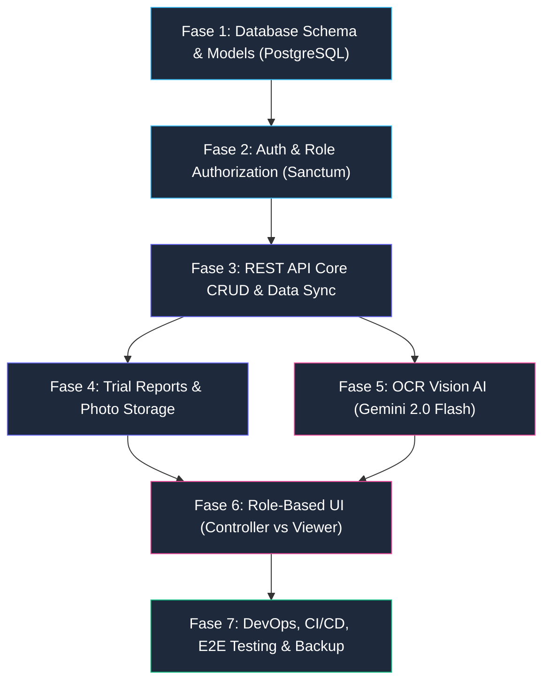

# MATRIX — Full-Stack Build Implementation Plan

Dokumen implementasi transisi dari prototype frontend-only (Next.js + in-memory store) ke aplikasi produksi full-stack (**Next.js 16 ↔ Laravel 13 API ↔ PostgreSQL**), dibagi menjadi **7 fase modular**. Setiap fase harus **diverifikasi dan disetujui** sebelum melanjutkan ke fase berikutnya.

---

## Ringkasan Keputusan Desain & Arsitektur

| Aspek | Keputusan Arsitektural |
|:---|:---|
| **Database** | **PostgreSQL** (Active di Laragon). Relasi relasional ketat, UUID primary key, indexes pada foreign keys & search columns. |
| **Vision AI (OCR)** | **Google Gemini 2.0 Flash** via API Studio (Free tier). Service abstraction di Laravel (`OcrService.php`) agar mudah switch ke pay-as-you-go jika volume naik. |
| **User & Role** | 2 Role: `controller` (Full CRUD, upload foto, edit table, trial reports) dan `viewer` (Read-only monitoring dashboard). User dibuat manual oleh Admin (Artisan command). |
| **Deployment** | **VPS (Docker)** pada tahap awal, siap migrasi ke **Server Internal Pabrik** (Docker + Cloudflare Tunnel). |
| **Scale & Concurrency** | 5–10 pengguna bersamaan. Single instance PostgreSQL + stateless Laravel API + Next.js SSR/CSR. |

---

## Target Arsitektur Sistem

```text
┌──────────────────────────┐         ┌──────────────────────────┐         ┌──────────────────────────┐
│        Next.js 16        │  REST   │        Laravel 13        │ Eloquent │        PostgreSQL        │
│        (Frontend)        │◄───────►│      (REST API Core)     │◄────────►│         (Database)       │
│                          │  JSON   │                          │          │                          │
│ • Controller Full-Action │         │ • Sanctum Authentication │          │ • Projects & JOs         │
│ • Viewer Read-Only UI    │         │ • Controllers & Requests │          │ • Categories & Items     │
│ • OCR Image Paste Preview│         │ • Policies & Middleware  │          │ • Controls & PO Tracking │
│ • App Router Pages       │         │ • OcrService (Gemini API)│          │ • Process & Trial Photos │
│ • API Client Layer       │         │ • Storage & Logging      │          │ • Trial Sessions/Reports │
└──────────────────────────┘         └──────────────────────────┘         └──────────────────────────┘
                                                   │
                                                   │ HTTPS
                                                   ▼
                                      ┌──────────────────────────┐
                                      │   Gemini 2.0 Flash API   │
                                      │ (Structured JSON Output) │
                                      └──────────────────────────┘
```

---

## 7 Fase Implementasi Modular



---

### Fase 1: Database Schema & Eloquent Models (PostgreSQL)

**Tujuan**: Membangun fondasi database PostgreSQL dan model layer yang bersih dan tervalidasi.

#### File Changes:
- `backend/database/migrations/`:
  - `create_projects_table.php` (id uuid PK, name, customer)
  - `create_jos_table.php` (id uuid PK, project_id FK, jo_number unique, product, type, target_date, finish_date)
  - `create_categories_table.php` (id uuid PK, jo_id FK, label, kind, is_custom, sort_order)
  - `create_items_table.php` (id uuid PK, category_id FK, no, description, dimension, material, qty, hrc, subcont fields, arrival_target_date)
  - `create_controls_table.php` (id uuid PK, item_id FK, process, status, notes, in_progress_at, target_date)
  - `create_po_trackings_table.php` (id uuid PK, control_id FK unique, supplier, po_no, po_date, target_arrival, notes)
  - `create_process_photos_table.php` (id uuid PK, control_id FK, name, path, added_at)
  - `create_activities_table.php` (id uuid PK, jo_id FK, message)
  - `create_trial_sessions_table.php` (id uuid PK, jo_id FK, name, trial_date, update_date, customer, job_no, pic_name, approved_by_name)
  - `create_trial_findings_table.php` (id uuid PK, trial_session_id FK, order)
  - `create_trial_entries_table.php` (id uuid PK, trial_finding_id FK, section, order, text, target_date, pic, status)
  - `create_trial_entry_photos_table.php` (id uuid PK, trial_entry_id FK, name, path, added_at)
- `backend/app/Models/`: Model classes dengan UUID trait, typed casts, dan eager-loading relationships.
- `backend/database/seeders/DemoSeeder.php`: Seeder data realistis (mereproduksi JO 126.110).

#### Verification Gate:
```bash
php artisan migrate:fresh --seed
php artisan test --filter=ModelTest
```

---

### Fase 2: Authentication & Role Authorization

**Tujuan**: Mengamankan sistem dengan login SPA (Sanctum) dan 2 role (`controller` dan `viewer`).

#### File Changes:
- `backend/database/migrations/`: Menambah kolom `role` (enum: `controller`, `viewer`) pada table `users`.
- `backend/app/Console/Commands/CreateUserCommand.php`: Artisan command `php artisan user:create {name} {email} {password} {--role=}` untuk admin.
- `backend/app/Http/Controllers/Auth/`: LoginController, LogoutController, MeController.
- `backend/app/Policies/`: ProjectPolicy, JOPolicy, ItemPolicy, TrialPolicy.
- `frontend/lib/auth.ts` & `frontend/app/login/page.tsx`: Next.js auth context, cookie session handling, login page.
- `frontend/middleware.ts`: Proteksi route dashboard/JO dari user non-login.

#### Verification Gate:
```bash
php artisan test --filter=AuthTest
```

---

### Fase 3: REST API Core CRUD & Data Sync

**Tujuan**: Memindahkan 30+ action types dari in-memory React store ke REST API endpoints berstandar tinggi.

#### File Changes:
- `backend/app/Http/Controllers/Api/`:
  - `ProjectController.php` (index, store, show)
  - `JOController.php` (store, show, finish)
  - `CategoryController.php` (store)
  - `ItemController.php` (store, batchStore, updateSubcont)
  - `ControlController.php` (updateStatus, updateTargetDate, updatePoTracking)
  - `BulkActionController.php` (bulkSendPo, bulkUpdateStatus, bulkSendSubcont, bulkTargetArrival)
  - `SubcontTrackerController.php` (cross-JO tracker query)
  - `PoTrackerController.php` (cross-JO tracker query)
- `backend/app/Http/Requests/`: Validasi ketat pada setiap payload.
- `backend/app/Http/Resources/`: JSON Resource transformers.
- `frontend/lib/api-client.ts`: Type-safe HTTP client dengan error handling.
- `frontend/lib/store.tsx`: Hubungkan UI ke API backend.

#### Verification Gate:
```bash
php artisan test --filter=Api
npm run test
```

---

### Fase 4: Trial Reports & Photo Storage

**Tujuan**: Persistensi data Trial Report bersarang (Session -> Finding -> Entry -> Photos) dan file storage management.

#### File Changes:
- `backend/app/Http/Controllers/Api/Trial/`: TrialSessionController, TrialFindingController, TrialEntryController.
- `backend/app/Services/PhotoUploadService.php`: Validasi magic-bytes gambar, sanitasi, resize/compression, storage disk.
- `frontend/components/trial-*.tsx`: Hubungkan trial editor & photo uploader ke backend.

#### Verification Gate:
```bash
php artisan test --filter=Trial
```

---

### Fase 5: OCR Vision AI (Gemini 2.0 Flash — Sole Production Path)

**Tujuan**: Implementasi auto-input part list dari paste/upload gambar tabel BOM menggunakan Google Gemini 2.0 Flash sebagai jalur tunggal produksi (arsip `ocr-lab/` dipertahankan terisolasi sebagai offline benchmark/riset dan tidak dihubungkan ke produksi).

#### File Changes:
- `backend/config/ocr.php`: Konfigurasi provider, single primary `GEMINI_API_KEY` + opsional `GEMINI_API_KEYS` rotation.
- `backend/app/Services/OcrService.php`: Gemini Vision client dengan *Structured JSON Schema* prompt, fail-loud error handling (zero-fabrication: tidak memalsukan data BOM saat API gagal/offline).
- `backend/app/Http/Controllers/Api/OcrController.php`: Endpoint `POST /api/ocr/extract` & `/api/categories/{category}/ocr-upload` terlindungi `auth.token`, `role.controller`, rate limiting `throttle:ocr`, validasi ukuran (max 15MB), magic-bytes MIME check (`image/jpeg`, `image/png`, `image/webp`), dan explicit user consent.
- `frontend/components/add-data-dialog.tsx`: Tangkap clipboard paste / drag-drop gambar -> staging thumbnail preview & explicit consent gating (zero silent upload) -> panggil API `/api/ocr/extract` -> tampilkan di tabel preview editable -> batch confirm import.
- `backend/tests/Feature/OcrSecurityTest.php` & `OcrTest.php`: Automated test suite memvalidasi autentikasi (401 unauthenticated), otorisasi (403 viewer), validasi consent & magic bytes (422), dan ekstraksi sukses.

#### Verification Gate:
```bash
php artisan test --filter=Ocr
```

---

### Fase 6: Role-Based UI (Controller vs Viewer)

**Tujuan**: Memisahkan antarmuka untuk role Controller (full control) dan Viewer (clean read-only monitoring).

#### File Changes:
- `frontend/components/app-shell.tsx`: Sembunyikan tombol Create untuk role Viewer.
- `frontend/components/control-table.tsx`: Mode read-only (disable cell clicks & hide checkbox) untuk Viewer.
- `frontend/app/subcont/page.tsx` & `po-tracker/page.tsx`: Mode read-only untuk Viewer.
- `frontend/components/trial-report-editor.tsx`: Mode view-only untuk Viewer.

#### Verification Gate:
```bash
npx playwright test --grep @roles
```

---

### Fase 7: DevOps, CI/CD, E2E Testing & Backup

**Tujuan**: Containerization Docker, automated CI/CD pipeline, Playwright E2E suites, and backup scheduling.

#### File Changes:
- `docker/Dockerfile.backend` (PHP 8.3 + Nginx + Composer multi-stage).
- `docker/Dockerfile.frontend` (Next.js 16 standalone).
- `docker-compose.yml`: Services (backend, frontend, postgres).
- `backend/app/Console/Commands/BackupDatabaseCommand.php`: Scheduled `pg_dump` backup.
- `.github/workflows/ci.yml` (atau `.gitlab-ci.yml`): Automated lint, test, build, docker verify.
- `testing/e2e/`: Playwright E2E tests (auth, jo-crud, ocr-paste, viewer-mode).

#### Verification Gate:
```bash
docker compose up -d --build
npx playwright test
```
